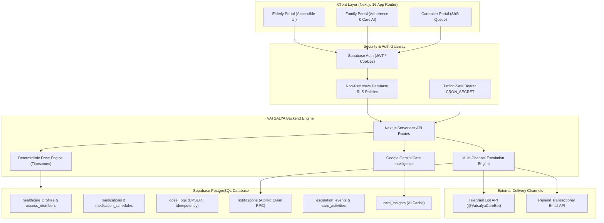
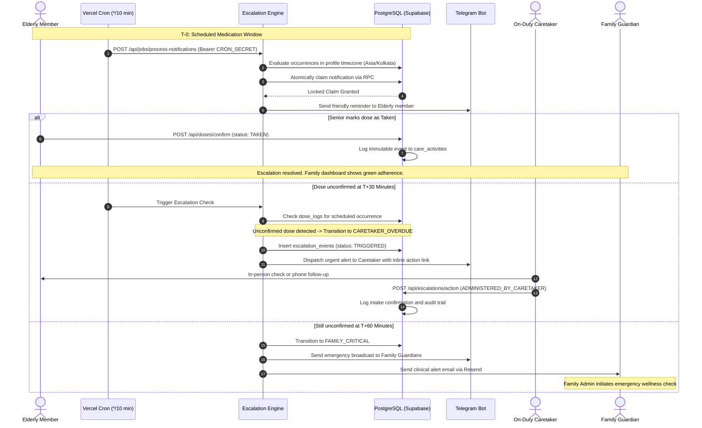

# VATSALYA (वात्सल्य)
> **Care beyond generations.**  
> *The Elderly Care & Medication Management Platform with Closed-Loop Escalations and Grounded AI Intelligence.*

[](https://nextjs.org)
[](https://www.typescriptlang.org)
[](https://tailwindcss.com)
[](https://supabase.com)
[](https://ai.google.dev)
[](https://vercel.com)
[](https://vitest.dev)
[](#repository-size-optimization)

---

## 1. Problem Statement & Mission

Elderly care management is plagued by three critical systemic breakdowns:
1. **Elderly Cognitive Overload & Loss of Autonomy:** Seniors are handed complicated multi-drug regimens without intuitive interfaces, or worse, treated as passive subjects while their autonomy is stripped away.
2. **Family Anxiety & Information Asymmetry:** Sons and daughters living across cities or countries worry constantly about whether parents took critical medications (blood pressure, diabetes, cardiac care) on time, often leading to stressful, intrusive phone calls.
3. **Broken Escalation Loops with Caretakers:** When an elderly member forgets or cannot take a dose, traditional apps simply post a quiet push notification that goes unnoticed. There is no automated, closed-loop escalation chain to on-duty caretakers and family guardians.

### The VATSALYA Solution
**VATSALYA** bridges these gaps by establishing a collaborative healthcare management ecosystem uniting **Elderly Individuals**, **Family Guardians**, and **Professional Caretakers**. 

The elderly individual remains central to their care decisions through high-contrast, large-touch interfaces with native regional language support (Kannada & English). If a dose remains unconfirmed past the clinical grace window, VATSALYA activates a multi-channel proactive escalation chain (Telegram bot audio/text alerts, Resend clinical emails, and caretaker shift queues) that guarantees accountability and peace of mind.

---

## 2. Key Differentiators

| Capability | Traditional Pill Reminders | VATSALYA Platform |
| :--- | :--- | :--- |
| **Elderly Autonomy** | Treats senior as passive target; apps designed for tech-savvy users | **Senior-First Ergonomics:** 64px touch targets, warm color contrast (Sage/Cream), audio speech prompts, Kannada/English toggles |
| **Escalation Loop** | Single static push notification; disappears if dismissed | **Multi-Tier Closed Loop:** T+0 Reminder $\to$ T+30m Caretaker Alert $\to$ T+60m Family Escalation $\to$ Mandatory Intake Resolution |
| **Concurrency & Lock Safety** | Vulnerable to duplicate dispatches on concurrent runs | **Atomic DB Claiming:** PostgreSQL RPC `claim_notification_for_processing` with `FOR UPDATE SKIP LOCKED` and stale lock recovery |
| **Care Coordination** | Fragmented chat apps and paper notes | **Passcode-Governed Access:** Short-lived 6-digit cryptographic passcodes for family and caretakers; zero insecure links |
| **Care Intelligence** | Hallucinatory, ungrounded AI chat bots | **Google Gemini Grounded Briefs:** Fact-checked summaries synthesizing verified dose logs, appointments, and caretaker follow-ups |
| **Audit & Compliance** | Ephemeral or easily deleted logs | **Immutable Care Activities:** Append-only timeline logging every confirmation, escalation follow-up, and doctor visit |

---

## 3. High-Level Architecture



---

## 4. Medication Escalation Lifecycle

VATSALYA implements a deterministic, clinically safe state machine for every medication occurrence:



---

## 5. Technology Stack

- **Framework:** [Next.js 16.4.6](https://nextjs.org/) (App Router, Turbopack, Server Actions, Serverless Route Handlers)
- **Language:** [TypeScript 5](https://www.typescriptlang.org/) (Strict typing, no any assertions in core domain)
- **Styling & UI:** [Tailwind CSS v4](https://tailwindcss.com/) with PostCSS `@tailwindcss/postcss`, Lucide Icons, and Accessible Healthcare Palette (Deep Forest `#1E3A2F`, Soft Cream `#FAF8F5`, Warm Sage `#EBF2EE`)
- **Database & Auth:** [Supabase](https://supabase.com/) (Managed PostgreSQL 15, Row-Level Security, Security Definer RPCs)
- **AI Synthesis:** [Google Gemini 2.5 Flash / 1.5 Flash](https://ai.google.dev/) with structured JSON schema output and deterministic clinical fallback
- **Messaging & Notifications:** Telegram Bot API (`node-telegram-bot-api` compatible serverless webhooks) & [Resend](https://resend.com/) Transactional Email
- **Testing:** [Vitest](https://vitest.dev/) (106 unit, integration, and security tests across 9 suites)
- **Deployment Platform:** [Vercel](https://vercel.com/) with native Vercel Cron (`vercel.json`)

---

## 6. Database Schema Overview

All 16 tables and 4 security functions are live and verified on Supabase:

1. `profiles`: Global user accounts linked directly to `auth.users(id)`.
2. `healthcare_profiles`: The core healthcare identity representing the elderly member.
3. `profile_access_members`: Granular role-based membership (`OWNER`, `FAMILY_ADMIN`, `FAMILY_VIEWER`, `CARETAKER`).
4. `profile_access_invitations`: Short-lived, single-use, 6-digit cryptographic passcode invites.
5. `medications`: Active, paused, and archived drug prescriptions.
6. `medication_schedules`: Detailed daily and weekly dosage frequencies, meal timings, and reminder lead times.
7. `dose_logs`: Idempotent record of dose confirmations and intake proof.
8. `appointments`: Clinical visits with doctors, clinic locations, and companion assignments.
9. `device_tokens`: Push notification registration ready for mobile clients.
10. `telegram_links`: Verified mappings between Supabase users and Telegram chat IDs.
11. `telegram_linking_tokens`: 15-minute cryptographically signed one-time bot linking tokens.
12. `notifications`: Multi-channel notification dispatch records with atomic claim status.
13. `notification_preferences`: Channel gating toggles (Telegram, Email, Push) and quiet hours.
14. `escalation_events`: Multi-tier escalation tracker (`CARETAKER_OVERDUE`, `FAMILY_CRITICAL`).
15. `care_activities`: Immutable, append-only clinical audit log.
16. `care_insights`: 4-hour cached AI daily briefs and adherence metrics.

### Security Definer Database Functions:
- `has_healthcare_access(target_profile_id UUID)`: Non-recursive membership verification preventing infinite loops.
- `has_healthcare_permission(target_profile_id UUID, required_permission TEXT)`: Fine-grained permission checker.
- `is_profile_owner_or_admin(target_profile_id UUID)`: Administrative action validator.
- `claim_notification_for_processing(p_worker_id TEXT, p_batch_size INT, p_stale_timeout_minutes INT)`: High-concurrency atomic locking function using `FOR UPDATE SKIP LOCKED`.

---

## 7. Security, Privacy & Clinical Safety

- **Zero PHI in AI Prompts:** AI prompts never receive government IDs, full street addresses, or payment information. Gemini only receives structured numerical adherence rates, scheduled times, and appointment types.
- **Strict Clinical Boundaries:** Gemini system instructions explicitly forbid medical diagnosis, drug recommendations, or prescription changes.
- **Timing-Safe Cron Authentication:** The `/api/jobs/process-notifications` endpoint enforces `Authorization: Bearer <CRON_SECRET>` verified via `crypto.timingSafeEqual` to eliminate timing side-channel attacks.
- **Fail-Closed Architecture:** If external providers (Telegram, Resend, or Gemini) fail or time out, the system fails closed, logs the error, retains the notification in `PENDING` status, and activates deterministic fallbacks.
- **Safe Database Credentials:** No credentials or API keys are ever committed to version control. The repository size is strictly tracked and maintained under 1.5 MB.

---

## 8. Local Setup & Installation

### Prerequisites
- Node.js 20.x or higher
- npm 10.x or higher

### Installation Steps

```bash
# 1. Clone repository
git clone https://github.com/your-org/vatsalya.git
cd vatsalya

# 2. Install dependencies
npm install

# 3. Create your local environment file
cp .env.example .env.local
```

### Environment Variables Reference (`.env.local`)

```ini
# SUPABASE (Live Database & Auth)
NEXT_PUBLIC_SUPABASE_URL=https://your-project.supabase.co
NEXT_PUBLIC_SUPABASE_ANON_KEY=your_supabase_anon_key
SUPABASE_SERVICE_ROLE_KEY=your_supabase_service_role_key

# TELEGRAM BOT INTEGRATION
TELEGRAM_BOT_TOKEN=your_telegram_bot_token
TELEGRAM_BOT_USERNAME=VatsalyaCareBot
TELEGRAM_WEBHOOK_SECRET=your_telegram_webhook_secret

# TRANSACTIONAL EMAIL (RESEND)
RESEND_API_KEY=re_your_resend_api_key
RESEND_FROM_EMAIL=VATSALYA Care <onboarding@resend.dev>

# CRON SECURITY (Vercel Cron & Background Jobs)
CRON_SECRET=your_strong_random_cron_secret

# GOOGLE GEMINI AI
GEMINI_API_KEY=your_gemini_api_key
GEMINI_MODEL=gemini-2.5-flash

# APPLICATION HOST
NEXT_PUBLIC_APP_URL=http://localhost:3000
```

---

## 9. Testing & Quality Verification

Run the comprehensive test suite and validation scripts:

```bash
# Run 106 Vitest unit, integration, and security tests
npm test

# Run ESLint validation (0 errors, 0 warnings enforced)
npm run lint

# Run Next.js production build with Turbopack
npm run build
```

---

## 10. Vercel-Only Deployment

VATSALYA is engineered specifically for zero-maintenance, serverless deployment on **Vercel**:

1. **Connect Repository to Vercel:** Import the project in your Vercel Dashboard.
2. **Configure Environment Variables:** Add all variables from `.env.local` to the Vercel Project Settings.
3. **Vercel Cron (`vercel.json`):**
   ```json
   {
     "crons": [
       {
         "path": "/api/jobs/process-notifications",
         "schedule": "*/10 * * * *"
       }
     ]
   }
   ```
4. **Deploy:** Click **Deploy**. Vercel will build the project using Turbopack and activate serverless route handlers automatically.
5. **Set Production Telegram Webhook:** Once deployed, set your Telegram webhook by calling:
   ```bash
   curl -X POST "https://api.telegram.org/bot<TELEGRAM_BOT_TOKEN>/setWebhook?url=https://<YOUR-VERCEL-DOMAIN>/api/telegram/webhook&secret_token=<TELEGRAM_WEBHOOK_SECRET>"
   ```

---

## 11. 3–5 Minute Hackathon Demonstration Walkthrough

1. **The Senior Experience (0:00 - 1:00):**
   - Navigate to `/dashboard/elderly`.
   - Highlight high-contrast typography, large 64px touch target, and bilingual Kannada/English instructions.
   - Click **"Mark as Taken (ತೆಗೆದುಕೊಂಡಿದ್ದೇನೆ)"**. Observe instantaneous UI state confirmation and haptic feedback.
2. **The Escalation Journey (1:00 - 2:15):**
   - Simulate an unconfirmed afternoon dose past the 30-minute grace window.
   - Show how Vercel Cron claims the notification atomically via PostgreSQL RPC.
   - Demonstrate the urgent Telegram alert sent to the assigned Caretaker: *"⚠️ Dose Overdue: Metformin (500 mg) for Appaji"*.
3. **The Caretaker Follow-Up (2:15 - 3:00):**
   - Open `/dashboard/caretaker`.
   - View the pending escalation queue.
   - Record an in-person follow-up action: **"Administered by Caretaker"**.
   - Show the escalation status automatically transitioning from `TRIGGERED` to `RESOLVED`.
4. **Family Peace of Mind & AI Daily Brief (3:00 - 4:00):**
   - Switch to `/dashboard/family`.
   - View 94% 7-day adherence metrics and the live activity audit trail showing the caretaker's intervention.
   - Click **"Refresh Summary"** on the AI Daily Care Brief to see Google Gemini generate an empathetic, factual synthesis of today's events with zero medical hallucination.
5. **Clinical Scheduling (4:00 - 4:30):**
   - Schedule an upcoming Cardiology checkup. Note the immediate appearance in both the Family and Elderly portals with assigned companion.

---

## 12. Repository Size & Optimization

- **Tracked Files:** 93 files (~0.95 MB)
- **Git Database (`.git`):** 1.4 MB
- **Total Clean Repository Size:** **1.44 MB** *(Strictly within the <10 MB hackathon requirement)*
- **Optimization Strategy:**
  - Removed unnecessary container configurations (`Dockerfile`, `.dockerignore`) in favor of native Vercel serverless.
  - Excluded bulky assets, font binaries, and temporary build caches from Git tracking.
  - Utilized modern SVG vector icons via Lucide React.

---

## 13. Hackathon Submission Summary

> **VATSALYA (वात्سل್ಯ)** is a production-grade elderly care and medication management platform built for families, seniors, and caretakers. Guided by the principle of **Elderly Autonomy**, it pairs senior-friendly accessible interfaces with a closed-loop multi-channel escalation engine (Telegram & Resend email). When a scheduled dose is missed, VATSALYA guarantees that no elderly person is forgotten—progressing through automated alerts to caretakers and family guardians. Powered by **Google Gemini**, the platform translates complex medication records, appointments, and care actions into empathetic, grounded daily briefs that grant families true peace of mind.

---

*VATSALYA — Care beyond generations.*
