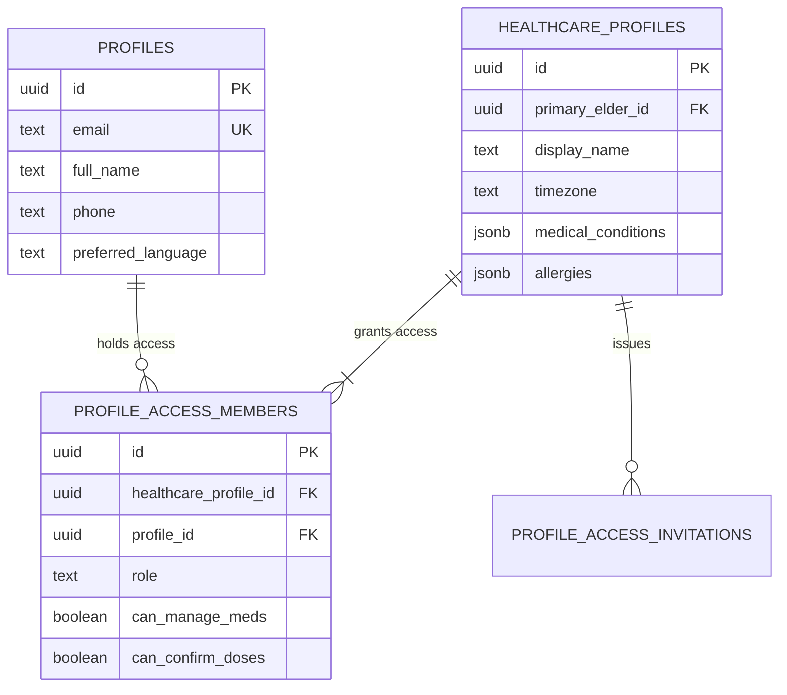
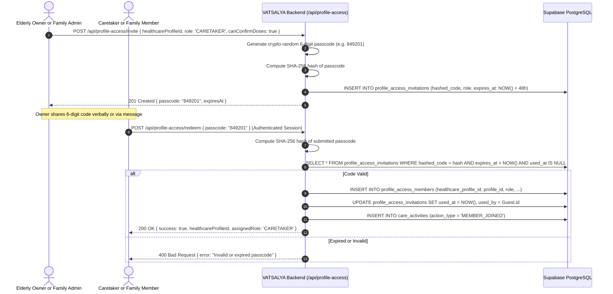
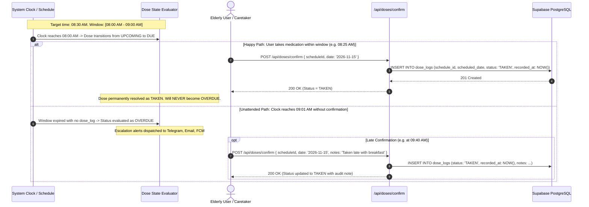
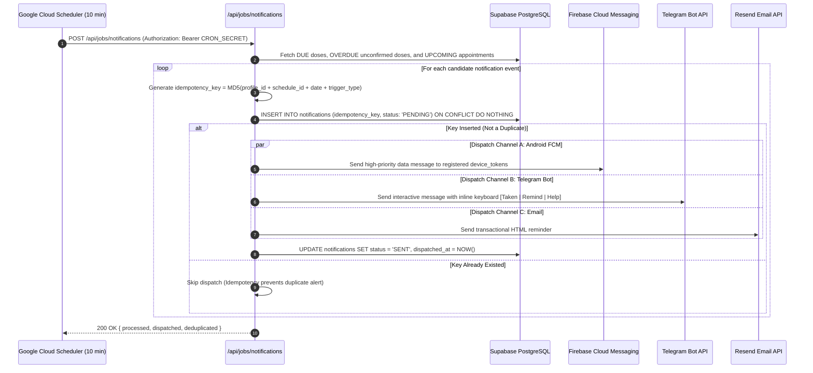
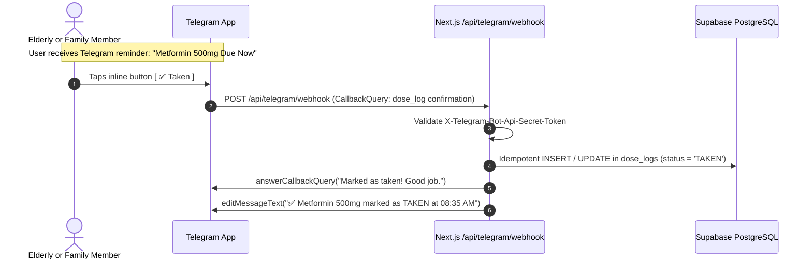

# VATSALYA (वात्सल्य) — Technical Architecture Specification

> **Architectural Tenet:** Modular monolith built on Next.js 15, containerized on Google Cloud Run. Strict separation between account identity and healthcare profile identity. Shared deterministic notification engine servicing three delivery channels: Android Push (FCM), Telegram Bot, and Resend Email.

---

## 1. High-Level Architecture Diagram

```mermaid
flowchart TD
    subgraph ClientChannels ["Client Channels & User Interfaces"]
        ElderlyWeb["Elderly High-Contrast Web Dashboard"]
        FamilyWeb["Family Member Collaborative Dashboard"]
        CaretakerWeb["Caretaker Shift Handover Dashboard"]
        TelegramClient["Telegram Client (Interactive Bot UI)"]
        AndroidClient["Future Android App (FCM Push Receiver)"]
    end

    subgraph CloudRunApp ["Next.js Unified Application (Google Cloud Run)"]
        direction TB
        AppRouter["Next.js App Router (SSR & RSC)"]
        AuthMiddleware["Server Auth & RBAC Middleware"]
        RouteHandlers["API Route Handlers (/api/*)"]

        subgraph CoreEngines ["Unified Server Business Engines"]
            DoseEngine["Deterministic Dose State Engine"]
            NotificationEngine["Unified 3-Channel Notification Dispatcher"]
            TelegramWebhookHandler["Telegram Webhook & Action Processor"]
            AuditEngine["Immutable Activity Audit Logger"]
            AIGateway["Sanitized Gemini 1.5 Flash Gateway"]
            VoiceGateway["Gnani.ai Speech & TTS Gateway"]
        end
    end

    subgraph DataTier ["Data & Authentication Tier (Supabase)"]
        SupaAuth["Supabase Auth (JWT / Sessions)"]
        PostgresDB[("Supabase PostgreSQL (Multi-Tenant RLS)")]
        SupaRealtime["Supabase Realtime (Live Dose Synchronization)"]
    end

    subgraph ExternalServices ["External Platform Services"]
        GeminiAPI["Google Gemini 1.5 Flash API"]
        GnaniAPI["Gnani.ai API (Kannada & English Voice)"]
        TelegramAPI["Official Telegram Bot API"]
        FCMService["Firebase Cloud Messaging (FCM)"]
        ResendAPI["Resend Email API"]
        CloudScheduler["Google Cloud Scheduler (10-min Cron)"]
        SecretManager["Google Secret Manager"]
    end

    %% Client traffic
    ElderlyWeb & FamilyWeb & CaretakerWeb -->|HTTPS| AuthMiddleware
    AuthMiddleware --> RouteHandlers
    TelegramClient <-->|Webhook / Inline Button Taps| TelegramWebhookHandler
    AndroidClient -.->|FCM Token Registration| RouteHandlers

    %% Auth & Data
    AuthMiddleware <-->|Verify JWT| SupaAuth
    RouteHandlers --> CoreEngines
    CoreEngines <-->|RLS Verified Queries| PostgresDB
    PostgresDB -.->|Postgres Changes WebSocket| SupaRealtime
    SupaRealtime -.->|Instant State Sync| ElderlyWeb & FamilyWeb

    %% External Connections
    NotificationEngine -->|Push Notifications| FCMService
    NotificationEngine -->|Interactive Messages| TelegramAPI
    NotificationEngine -->|Transactional Emails| ResendAPI
    TelegramWebhookHandler -->|Update Dose Status| DoseEngine
    AIGateway -->|Sanitized Structured Summaries| GeminiAPI
    VoiceGateway -->|STT / TTS Requests| GnaniAPI
    CloudScheduler -->|Bearer Protected POST| RouteHandlers
    SecretManager -.->|Runtime Env Vars Injection| CloudRunApp
```

---

## 2. Core Architectural Principles & Identity Modeling

### 2.1 Identity Decoupling: Account vs. Healthcare Profile
- **Account Identity (`profiles`):** Represents an authenticated individual (Full Name, Email, Password, Phone Number, Preferred Language). Authenticated via Supabase Auth.
- **Healthcare Profile Identity (`healthcare_profiles`):** Represents the clinical entity (Date of Birth, Blood Group, Timezone, Allergies, Medical Conditions, Primary Doctor, Emergency Contact).
- **Decoupled Relationship:**
  - An elderly person can sign up and directly own their healthcare profile (`primary_elder_id = auth.uid()`).
  - An adult daughter (Priya) can sign up and create a healthcare profile for her father (`primary_elder_id = NULL` or linked to father's account if registered later). Priya becomes the initial `FAMILY_ADMIN`.
  - All access permissions are mapped through the `profile_access_members` join table.

---

## 3. End-to-End System Flows

### 3.1 Passcode-Based Access Flow (No Static Passcodes)

### 3.2 Medication Scheduling & Deterministic Dose State Flow

`TAKEN` and `OVERDUE` are **alternative execution outcomes**, not sequential states:

### 3.3 Three-Channel Notification & Deduplication Architecture

### 3.4 Interactive Telegram Bot Webhook Flow

---

## 4. Google Cloud Run Production Deployment Architecture

- **Containerization:** Multi-stage Docker build packaging the Next.js standalone server (`output: 'standalone'`).
- **Port:** Container listens on port `8080`, mapped automatically by Cloud Run.
- **Scaling Parameters:**
  - `min-instances: 1`: Retains 1 warm instance at all times to guarantee instant responses during hackathon judging.
  - `max-instances: 5`: Governs cloud cost while supporting concurrent user spikes.
- **Environment & Secrets:**
  - Injected via Google Secret Manager bindings. Zero secrets stored in source control or client JavaScript bundles.
- **Health Check Endpoint:** `/api/health` continuously monitored by Cloud Run startup and liveness probes.
