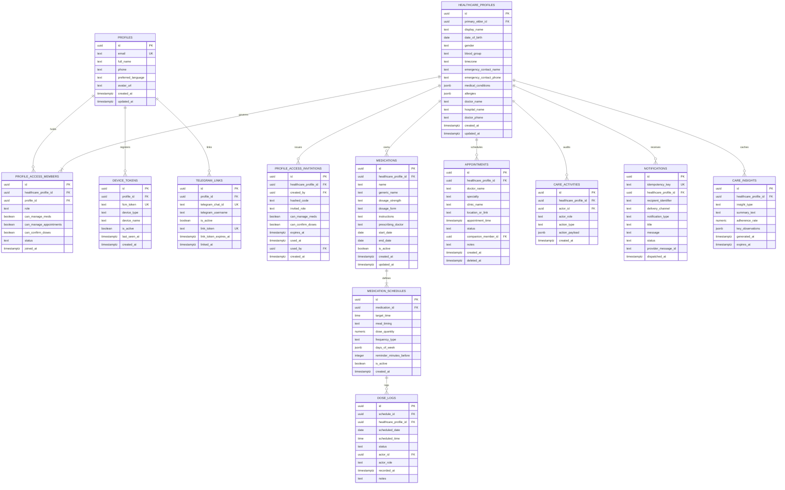

# VATSALYA (वात्सल्य) — Database Schema & Security Specification

> **RDBMS:** Supabase PostgreSQL 15+  
> **Security Model:** Row Level Security (RLS) enabled on 100% of tables. Access resolved through verified active rows in `profile_access_members`. Zero usage of obsolete terminology.

---

## 1. Complete Entity Relationship (ER) Model



---

## 2. Table Specifications & Column Definitions

### 2.1 Table: `profiles`
- **Purpose:** User account identity linked 1:1 with Supabase `auth.users`.
- **Columns:**
  - `id`: `uuid PRIMARY KEY REFERENCES auth.users(id) ON DELETE CASCADE`
  - `email`: `text NOT NULL UNIQUE`
  - `full_name`: `text NOT NULL`
  - `phone`: `text`
  - `preferred_language`: `text NOT NULL DEFAULT 'en'` (`'en'`, `'kn'`, `'hi'`)
  - `avatar_url`: `text`
  - `created_at`: `timestamptz DEFAULT now() NOT NULL`
  - `updated_at`: `timestamptz DEFAULT now() NOT NULL`

### 2.2 Table: `healthcare_profiles`
- **Purpose:** Central clinical health record of the elderly individual.
- **Columns:**
  - `id`: `uuid PRIMARY KEY DEFAULT gen_random_uuid()`
  - `primary_elder_id`: `uuid REFERENCES profiles(id) ON DELETE SET NULL`
  - `display_name`: `text NOT NULL` (e.g. "Appaji", "Savitri Amma")
  - `date_of_birth`: `date NOT NULL`
  - `gender`: `text` (`'MALE'`, `'FEMALE'`, `'OTHER'`)
  - `blood_group`: `text` (`'A+'`, `'B+'`, `'O+'`, `'AB+'`, etc.)
  - `timezone`: `text NOT NULL DEFAULT 'Asia/Kolkata'`
  - `emergency_contact_name`: `text NOT NULL`
  - `emergency_contact_phone`: `text NOT NULL`
  - `medical_conditions`: `jsonb DEFAULT '[]'::jsonb NOT NULL`
  - `allergies`: `jsonb DEFAULT '[]'::jsonb NOT NULL`
  - `doctor_name`: `text`
  - `hospital_name`: `text`
  - `doctor_phone`: `text`
  - `created_at`: `timestamptz DEFAULT now() NOT NULL`
  - `updated_at`: `timestamptz DEFAULT now() NOT NULL`

### 2.3 Table: `profile_access_members`
- **Purpose:** Defines which user accounts have access to which healthcare profile under what role and permissions.
- **Columns:**
  - `id`: `uuid PRIMARY KEY DEFAULT gen_random_uuid()`
  - `healthcare_profile_id`: `uuid NOT NULL REFERENCES healthcare_profiles(id) ON DELETE CASCADE`
  - `profile_id`: `uuid NOT NULL REFERENCES profiles(id) ON DELETE CASCADE`
  - `role`: `text NOT NULL CHECK (role IN ('ELDERLY', 'FAMILY_ADMIN', 'FAMILY_VIEWER', 'CARETAKER'))`
  - `can_manage_meds`: `boolean NOT NULL DEFAULT false`
  - `can_manage_appointments`: `boolean NOT NULL DEFAULT false`
  - `can_confirm_doses`: `boolean NOT NULL DEFAULT true`
  - `status`: `text NOT NULL DEFAULT 'ACTIVE' CHECK (status IN ('ACTIVE', 'INVITED', 'SUSPENDED'))`
  - `joined_at`: `timestamptz DEFAULT now() NOT NULL`
- **Constraints:**
  - `UNIQUE (healthcare_profile_id, profile_id)`

### 2.4 Table: `profile_access_invitations`
- **Purpose:** Secure 6-digit passcode-based invitations with 48-hour expiration.
- **Columns:**
  - `id`: `uuid PRIMARY KEY DEFAULT gen_random_uuid()`
  - `healthcare_profile_id`: `uuid NOT NULL REFERENCES healthcare_profiles(id) ON DELETE CASCADE`
  - `created_by`: `uuid NOT NULL REFERENCES profiles(id)`
  - `hashed_code`: `text NOT NULL` (SHA-256 hash of 6-digit passcode)
  - `invited_role`: `text NOT NULL CHECK (invited_role IN ('FAMILY_ADMIN', 'FAMILY_VIEWER', 'CARETAKER'))`
  - `can_manage_meds`: `boolean NOT NULL DEFAULT false`
  - `can_confirm_doses`: `boolean NOT NULL DEFAULT true`
  - `expires_at`: `timestamptz NOT NULL`
  - `used_at`: `timestamptz`
  - `used_by`: `uuid REFERENCES profiles(id)`
  - `created_at`: `timestamptz DEFAULT now() NOT NULL`

### 2.5 Table: `medications`
- **Purpose:** Pharmaceutical master record.
- **Columns:**
  - `id`: `uuid PRIMARY KEY DEFAULT gen_random_uuid()`
  - `healthcare_profile_id`: `uuid NOT NULL REFERENCES healthcare_profiles(id) ON DELETE CASCADE`
  - `name`: `text NOT NULL`
  - `generic_name`: `text`
  - `dosage_strength`: `text NOT NULL` (e.g. "500 mg")
  - `dosage_form`: `text NOT NULL CHECK (dosage_form IN ('TABLET', 'CAPSULE', 'SYRUP', 'INJECTION', 'DROPS', 'INHALER', 'OTHER'))`
  - `instructions`: `text` (e.g. "Take with warm water")
  - `prescribing_doctor`: `text`
  - `start_date`: `date NOT NULL DEFAULT CURRENT_DATE`
  - `end_date`: `date`
  - `is_active`: `boolean NOT NULL DEFAULT true`
  - `created_at`: `timestamptz DEFAULT now() NOT NULL`
  - `updated_at`: `timestamptz DEFAULT now() NOT NULL`

### 2.6 Table: `medication_schedules`
- **Purpose:** Daily time slot definition for each medication.
- **Columns:**
  - `id`: `uuid PRIMARY KEY DEFAULT gen_random_uuid()`
  - `medication_id`: `uuid NOT NULL REFERENCES medications(id) ON DELETE CASCADE`
  - `target_time`: `time NOT NULL` (e.g. "08:30:00")
  - `meal_timing`: `text NOT NULL CHECK (meal_timing IN ('BEFORE_MEAL', 'WITH_MEAL', 'AFTER_MEAL', 'EMPTY_STOMACH', 'NO_RESTRICTION'))`
  - `dose_quantity`: `numeric NOT NULL DEFAULT 1.0`
  - `frequency_type`: `text NOT NULL DEFAULT 'DAILY' CHECK (frequency_type IN ('DAILY', 'SPECIFIC_DAYS', 'AS_NEEDED'))`
  - `days_of_week`: `jsonb DEFAULT '[0,1,2,3,4,5,6]'::jsonb`
  - `reminder_minutes_before`: `integer NOT NULL DEFAULT 15`
  - `is_active`: `boolean NOT NULL DEFAULT true`
  - `created_at`: `timestamptz DEFAULT now() NOT NULL`

### 2.7 Table: `dose_logs`
- **Purpose:** Daily execution and audit record for each scheduled dose occurrence.
- **Columns:**
  - `id`: `uuid PRIMARY KEY DEFAULT gen_random_uuid()`
  - `schedule_id`: `uuid NOT NULL REFERENCES medication_schedules(id) ON DELETE CASCADE`
  - `healthcare_profile_id`: `uuid NOT NULL REFERENCES healthcare_profiles(id) ON DELETE CASCADE`
  - `scheduled_date`: `date NOT NULL`
  - `scheduled_time`: `time NOT NULL`
  - `status`: `text NOT NULL CHECK (status IN ('UPCOMING', 'DUE', 'TAKEN', 'OVERDUE', 'MISSED', 'SKIPPED', 'UNCONFIRMED'))`
  - `actor_id`: `uuid REFERENCES profiles(id)`
  - `actor_role`: `text CHECK (actor_role IN ('ELDERLY', 'FAMILY_ADMIN', 'FAMILY_VIEWER', 'CARETAKER', 'SYSTEM'))`
  - `recorded_at`: `timestamptz DEFAULT now() NOT NULL`
  - `notes`: `text`
- **Constraints:**
  - `UNIQUE (schedule_id, scheduled_date)` — Strict idempotency guarantee against duplicate confirmations.

### 2.8 Table: `appointments`
- **Purpose:** Medical visits, clinic follow-ups, and assigned companions.
- **Columns:**
  - `id`: `uuid PRIMARY KEY DEFAULT gen_random_uuid()`
  - `healthcare_profile_id`: `uuid NOT NULL REFERENCES healthcare_profiles(id) ON DELETE CASCADE`
  - `doctor_name`: `text NOT NULL`
  - `specialty`: `text NOT NULL`
  - `clinic_name`: `text NOT NULL`
  - `location_or_link`: `text NOT NULL`
  - `appointment_time`: `timestamptz NOT NULL`
  - `status`: `text NOT NULL DEFAULT 'SCHEDULED' CHECK (status IN ('SCHEDULED', 'COMPLETED', 'CANCELLED', 'RESCHEDULED'))`
  - `companion_member_id`: `uuid REFERENCES profiles(id)`
  - `notes`: `text`
  - `created_at`: `timestamptz DEFAULT now() NOT NULL`
  - `deleted_at`: `timestamptz`

### 2.9 Table: `device_tokens` (Channel A: Android FCM Ready)
- **Purpose:** Stores Android FCM registration tokens for push notifications.
- **Columns:**
  - `id`: `uuid PRIMARY KEY DEFAULT gen_random_uuid()`
  - `profile_id`: `uuid NOT NULL REFERENCES profiles(id) ON DELETE CASCADE`
  - `fcm_token`: `text NOT NULL UNIQUE`
  - `device_type`: `text NOT NULL DEFAULT 'ANDROID'`
  - `device_name`: `text`
  - `is_active`: `boolean NOT NULL DEFAULT true`
  - `last_seen_at`: `timestamptz DEFAULT now() NOT NULL`
  - `created_at`: `timestamptz DEFAULT now() NOT NULL`

### 2.10 Table: `telegram_links` (Channel B: Telegram Bot)
- **Purpose:** Links verified Telegram chat IDs to user accounts for interactive messaging.
- **Columns:**
  - `id`: `uuid PRIMARY KEY DEFAULT gen_random_uuid()`
  - `profile_id`: `uuid NOT NULL REFERENCES profiles(id) ON DELETE CASCADE`
  - `telegram_chat_id`: `text NOT NULL UNIQUE`
  - `telegram_username`: `text`
  - `is_active`: `boolean NOT NULL DEFAULT true`
  - `link_token`: `text UNIQUE`
  - `link_token_expires_at`: `timestamptz`
  - `linked_at`: `timestamptz DEFAULT now() NOT NULL`

### 2.11 Table: `notifications` (Shared Engine Deduplication Store)
- **Purpose:** Unified dispatch audit and idempotency store for all 3 channels.
- **Columns:**
  - `id`: `uuid PRIMARY KEY DEFAULT gen_random_uuid()`
  - `idempotency_key`: `text NOT NULL UNIQUE`
  - `healthcare_profile_id`: `uuid NOT NULL REFERENCES healthcare_profiles(id) ON DELETE CASCADE`
  - `recipient_identifier`: `text NOT NULL` (email, telegram chat_id, or fcm_token)
  - `delivery_channel`: `text NOT NULL CHECK (delivery_channel IN ('ANDROID_FCM', 'TELEGRAM', 'EMAIL'))`
  - `notification_type`: `text NOT NULL CHECK (notification_type IN ('UPCOMING_DOSE', 'OVERDUE_DOSE', 'MISSED_DOSE', 'UPCOMING_APPOINTMENT', 'ESCALATION_ALERT'))`
  - `title`: `text NOT NULL`
  - `message`: `text NOT NULL`
  - `status`: `text NOT NULL CHECK (status IN ('PENDING', 'SENT', 'FAILED', 'SKIPPED'))`
  - `provider_message_id`: `text` (Resend ID, Telegram message_id, or FCM message_id)
  - `dispatched_at`: `timestamptz DEFAULT now() NOT NULL`

### 2.12 Table: `care_activities`
- **Purpose:** Immutable audit timeline of clinical and operational actions.
- **Columns:**
  - `id`: `uuid PRIMARY KEY DEFAULT gen_random_uuid()`
  - `healthcare_profile_id`: `uuid NOT NULL REFERENCES healthcare_profiles(id) ON DELETE CASCADE`
  - `actor_id`: `uuid REFERENCES profiles(id)`
  - `actor_role`: `text NOT NULL`
  - `action_type`: `text NOT NULL`
  - `action_payload`: `jsonb DEFAULT '{}'::jsonb NOT NULL`
  - `created_at`: `timestamptz DEFAULT now() NOT NULL`

### 2.13 Table: `care_insights`
- **Purpose:** Caching layer for Gemini-generated summaries and adherence statistics.
- **Columns:**
  - `id`: `uuid PRIMARY KEY DEFAULT gen_random_uuid()`
  - `healthcare_profile_id`: `uuid NOT NULL REFERENCES healthcare_profiles(id) ON DELETE CASCADE`
  - `insight_type`: `text NOT NULL CHECK (insight_type IN ('DAILY_BRIEF', 'WEEKLY_ADHERENCE', 'HANDOVER_SUMMARY'))`
  - `summary_text`: `text NOT NULL`
  - `adherence_rate`: `numeric`
  - `key_observations`: `jsonb DEFAULT '[]'::jsonb`
  - `generated_at`: `timestamptz DEFAULT now() NOT NULL`
  - `expires_at`: `timestamptz NOT NULL`

---

## 3. Row Level Security (RLS) Implementation

### 3.1 Core Security Function: `has_healthcare_access`

```sql
CREATE OR REPLACE FUNCTION public.has_healthcare_access(
    target_profile_id UUID
)
RETURNS BOOLEAN
LANGUAGE sql
SECURITY DEFINER
STABLE
SET search_path = public
AS $$
    SELECT EXISTS (
        SELECT 1 
        FROM public.profile_access_members pam
        WHERE pam.healthcare_profile_id = target_profile_id
          AND pam.profile_id = auth.uid()
          AND pam.status = 'ACTIVE'
    );
$$;
```

### 3.2 Granular RLS Policies

```sql
-- 1. PROFILES
ALTER TABLE public.profiles ENABLE ROW LEVEL SECURITY;
CREATE POLICY "Users can view self or peers with shared healthcare access"
ON public.profiles FOR SELECT
USING (
    id = auth.uid() OR
    id IN (
        SELECT pam2.profile_id 
        FROM public.profile_access_members pam1
        JOIN public.profile_access_members pam2 ON pam1.healthcare_profile_id = pam2.healthcare_profile_id
        WHERE pam1.profile_id = auth.uid()
    )
);

CREATE POLICY "Users can update their own account profile"
ON public.profiles FOR UPDATE
USING (id = auth.uid());

-- 2. HEALTHCARE_PROFILES
ALTER TABLE public.healthcare_profiles ENABLE ROW LEVEL SECURITY;
CREATE POLICY "Authorized members can read healthcare profile"
ON public.healthcare_profiles FOR SELECT
USING (public.has_healthcare_access(id));

CREATE POLICY "Owners and Family Admins can update healthcare profile"
ON public.healthcare_profiles FOR UPDATE
USING (
    EXISTS (
        SELECT 1 FROM public.profile_access_members pam
        WHERE pam.healthcare_profile_id = id
          AND pam.profile_id = auth.uid()
          AND pam.role IN ('ELDERLY', 'FAMILY_ADMIN')
    )
);

-- 3. MEDICATIONS & SCHEDULES
ALTER TABLE public.medications ENABLE ROW LEVEL SECURITY;
CREATE POLICY "Authorized members can view medications"
ON public.medications FOR SELECT
USING (public.has_healthcare_access(healthcare_profile_id));

CREATE POLICY "Authorized members can modify medications"
ON public.medications FOR ALL
USING (
    EXISTS (
        SELECT 1 FROM public.profile_access_members pam
        WHERE pam.healthcare_profile_id = healthcare_profile_id
          AND pam.profile_id = auth.uid()
          AND (pam.role IN ('ELDERLY', 'FAMILY_ADMIN') OR pam.can_manage_meds = true)
    )
);

-- 4. DOSE_LOGS
ALTER TABLE public.dose_logs ENABLE ROW LEVEL SECURITY;
CREATE POLICY "Authorized members can view dose logs"
ON public.dose_logs FOR SELECT
USING (public.has_healthcare_access(healthcare_profile_id));

CREATE POLICY "Authorized members can confirm doses"
ON public.dose_logs FOR INSERT
WITH CHECK (
    public.has_healthcare_access(healthcare_profile_id) AND
    EXISTS (
        SELECT 1 FROM public.profile_access_members pam
        WHERE pam.healthcare_profile_id = healthcare_profile_id
          AND pam.profile_id = auth.uid()
          AND pam.can_confirm_doses = true
    )
);
```
