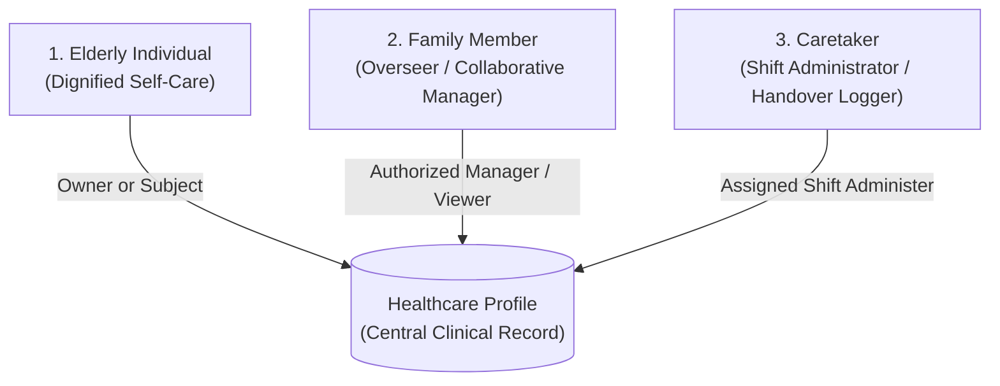
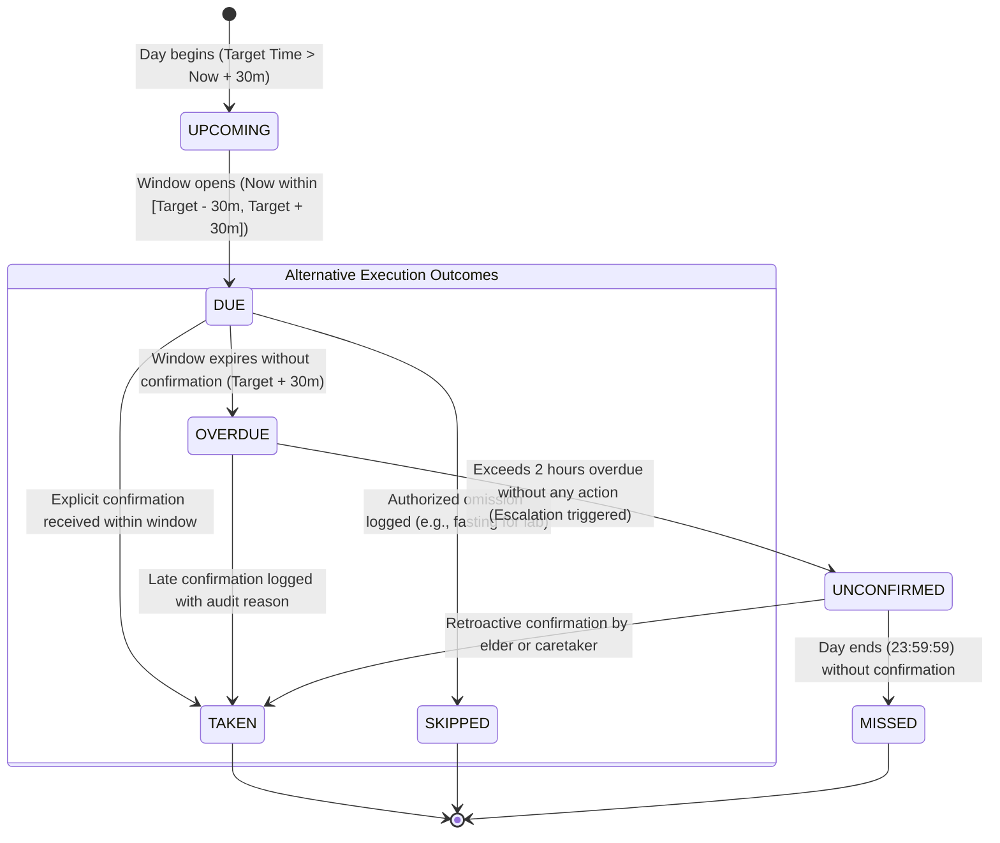
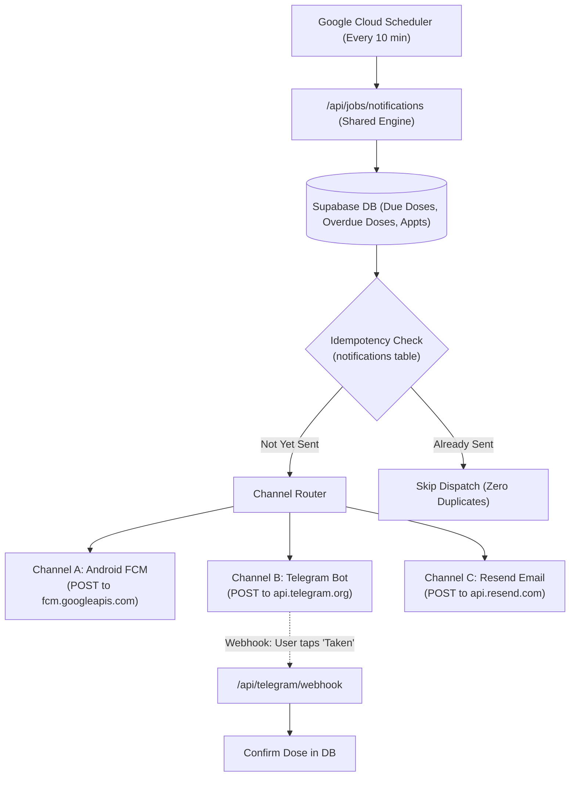

# VATSALYA (वात्सल्य) — Product Requirements Document (PRD)

> **Working Tagline:** Care beyond generations.  
> **Category:** AI-powered elderly healthcare and medication management platform.  
> **Brand Identity:** Sanskrit *Vatsalya* denotes tender affection, unconditional nurturing, and compassionate protection.  
> **Core Philosophy:** Technology should not make elderly individuals feel dependent. It should safeguard their dignity, independence, and control while keeping authorized family members and caretakers connected. The elderly individual remains at the centre of every healthcare decision.

---

## 1. Problem Statement Alignment & Official Challenge Scope

### 1.1 The Official Challenge Context
The competition challenge requires a smart, interconnected healthcare management platform designed to help elderly individuals manage:
- Daily medications (multi-dose regimens, strict timing, instructions).
- Medical appointments (consultations, clinical follow-ups, companions).
- Healthcare routines and caregiver handovers.

It mandates a shared ecosystem where **elderly individuals, caretakers, and family members** access and manage an elderly person's healthcare profile through **secure passcode-based access**. Authorized members can:
- View healthcare profiles.
- Add, edit, and manage medication schedules.
- Track medication adherence.
- Monitor upcoming doctor appointments.
- Receive reminders for upcoming doses and appointments.
- Receive alerts for missed or overdue medications across multiple communication channels.

### 1.2 Core Architectural Corrections & Terminology Governance
- **Strict Terminology Directive:** The phrase "Care Circle" is completely retired and prohibited. The platform operates on **Healthcare Profiles**, **Profile Access Roles**, and **Passcode-Based Access Links**.
- **Separation of Account Identity vs. Healthcare Profile Identity:** An account (`users` / `profiles`) represents an authenticated human. A healthcare profile (`healthcare_profiles`) represents the clinical record of an elderly individual. An elderly individual may own their healthcare profile directly, OR an authorized family member can create and manage a healthcare profile on behalf of an aging parent.
- **Three Unified Notification Delivery Channels:**
  1. **Android Push Notifications (FCM):** API endpoints and database schema prepared now for the future native Android mobile app.
  2. **Telegram Bot:** Interactive, two-way notifications (`Taken`, `Remind me later`, `Need help`) and appointment reminders via official Telegram Bot API webhooks.
  3. **Email:** Transactional reminders and escalation dispatch powered by Resend.
  All channels consume a single, unified backend notification engine querying verified database records.

---

## 2. User Roles & Granular Permissions Framework

### 2.1 The Three Roles

1. **Elderly Individual (Primary User / Profile Subject):**
   - Central to every decision.
   - Views their daily medication timeline and upcoming doctor visits in an ultra-clean, high-contrast, large-font interface.
   - Explicitly confirms doses taken with a single tap (or via Telegram action).
   - Controls who has access to their healthcare profile and can revoke access anytime.
   - Requests immediate help from emergency contacts.

2. **Family Member:**
   - Either manages the profile on behalf of an elder or collaborates as an authorized observer/manager.
   - Views medication adherence history and doctor visits.
   - Adds/edits medication schedules and appointments if granted management permissions.
   - Receives overdue alerts and escalation summaries across Telegram, Email, and future Android push.

3. **Caretaker:**
   - Assigned to assist during designated shifts.
   - Views daily medication checklists.
   - Confirms dose administration when authorized (audited with caretaker identity).
   - Records care activity and shift handover notes.
   - Reports unresolved patient issues.

### 2.2 Granular Permissions Matrix

| Capability | Elderly Individual (Owner) | Family Member (Manager) | Family Member (Viewer) | Caretaker (Administer) | Caretaker (Viewer) |
| :--- | :---: | :---: | :---: | :---: | :---: |
| **View Healthcare Profile & Clinical History** | ✅ | ✅ | ✅ | ✅ | ✅ |
| **Edit Clinical Details (Allergies, Conditions)** | ✅ | ✅ | ❌ | ❌ | ❌ |
| **Self-Confirm Medication as Taken** | ✅ | ❌ | ❌ | ❌ | ❌ |
| **Record Medication Administered on Behalf** | ❌ | ✅ | ❌ | ✅ | ❌ |
| **Add / Edit / Deactivate Medication Schedules** | ✅ | ✅ | ❌ | ❌ | ❌ |
| **Schedule / Reschedule Doctor Appointments** | ✅ | ✅ | ❌ | ✅ (if granted) | ❌ |
| **Generate Passcode-Based Access Invitations** | ✅ | ✅ | ❌ | ❌ | ❌ |
| **Revoke Member Access / Alter Roles** | ✅ | ❌ | ❌ | ❌ | ❌ |
| **Log Shift Handover Notes & Vitals** | ✅ | ✅ | ❌ | ✅ | ❌ |
| **Receive Overdue Alert Escalations** | ❌ | ✅ | ✅ (opt-in) | ✅ (during shift) | ❌ |
| **Link Telegram Account for Reminders** | ✅ | ✅ | ✅ | ✅ | ❌ |
| **Register Android Device Token (FCM)** | ✅ | ✅ | ✅ | ✅ | ❌ |

---

## 3. Registration, Onboarding & Passcode-Based Access

### 3.1 Two-Stage Onboarding Flow
1. **Account Registration (Supabase Auth):**
   - Full name, Email, Password, Phone Number, Preferred Language (`en`, `kn`, `hi`).
   - Creates authenticated session and base user record in `profiles`.
2. **Healthcare Profile Initialization:**
   - Can be initialized by the elderly user themselves or by a family member creating a profile for an elder.
   - Required Clinical Fields: Full Name, Date of Birth, Gender (optional), Time Zone (default: `Asia/Kolkata`), Emergency Contact Name & Phone, Known Allergies (array), Existing Medical Conditions (array), Current Primary Doctor & Hospital.

### 3.2 Secure Passcode-Based Access Architecture
- **Problem Statement Requirement:** Secure passcode-based access allowing family and caretakers to link to an elderly individual's healthcare profile.
- **Security Design (No Static Shared Secrets):**
  - Static passcodes shared on sticky notes are a catastrophic healthcare vulnerability.
  - VATSALYA implements **cryptographic, time-limited, role-scoped passcodes**:
    1. Authorized owner/admin generates a 6-digit numeric passcode (e.g. `849201`) bound to a specific role (`FAMILY_VIEWER`, `CARETAKER`).
    2. Passcode is hashed using SHA-256 before storage in `profile_access_invitations`.
    3. Expires automatically after **48 hours** or upon first successful redemption.
    4. Authenticated users redeem the passcode at `/join` or `/api/profile-access/redeem`, binding their account to the healthcare profile in `profile_access_members`.
    5. The elderly individual can view all active accesses and click "Revoke" at any time.

---

## 4. Medication Management & Deterministic Dose State Engine

### 4.1 Data Modeling Separation
- **Medication Entity (`medications`):** Pharmaceutical master record (Drug name, strength, form, prescribing doctor, start/end date, general instructions).
- **Medication Schedule Entity (`medication_schedules`):** Precise daily timing rules (Target time, meal context: `BEFORE_MEAL`, `WITH_MEAL`, `AFTER_MEAL`, `EMPTY_STOMACH`, frequency: `DAILY`, `SPECIFIC_DAYS`, `AS_NEEDED`).
- **Dose Log Entity (`dose_logs`):** Concrete daily dose instance recording actual execution vs. scheduled target.

### 4.2 Deterministic Dose State Machine

#### Deterministic Rules & Medical Integrity:
1. **Alternative Outcomes, Not Sequential:** `TAKEN` and `OVERDUE` are distinct branches from `DUE`. A dose does not become "overdue" before it is taken on time; it only transitions to `OVERDUE` if the time window elapses without confirmation.
2. **No Presumptive Classification:** An unconfirmed dose is marked `UNCONFIRMED`, never presumed definitely taken or missed.
3. **Explicit Actor Audit:** Doses recorded by an elderly user reflect `actor_role = 'ELDERLY'`. Doses administered by a nurse reflect `actor_role = 'CARETAKER'` with accompanying clinical notes.
4. **Idempotency Guarantee:** Unique database constraint on `(schedule_id, scheduled_date)` prevents double-confirmation races.

---

## 5. Three Unified Notification Channels

### Channel A: Android Push Notifications (Architecture Ready)
- While the mobile app is planned for future native Android release, all backend foundations are fully specified:
  - Table: `device_tokens` stores FCM registration tokens, device OS, and active state.
  - APIs: `POST /api/notifications/devices` (register), `DELETE /api/notifications/devices` (revoke).
  - FCM Payload Schema: High-priority data notifications containing `dose_log_id`, `medication_name`, and action buttons (`CONFIRM_TAKEN`, `SNOOZE`).

### Channel B: Interactive Telegram Bot
- Connects using official Telegram Bot API (`https://api.telegram.org/bot<TOKEN>/`).
- **Linking Flow:** User opens `t.me/VatsalyaCareBot?start=<LINK_TOKEN>`, sending a unique link token that associates their Telegram `chat_id` with their VATSALYA user profile.
- **Interactive Inline Keyboards:**
  - `[ ✅ Taken ]` — Triggers instant webhook callback marking the dose as taken in Supabase.
  - `[ ⏰ Remind in 15m ]` — Reschedules notification trigger.
  - `[ 🆘 Need Help ]` — Alerts primary family emergency contact.
- **Security:** Webhook endpoint `/api/telegram/webhook` validates `X-Telegram-Bot-Api-Secret-Token`.

### Channel C: Transactional Email via Resend
- High-contrast, WCAG-compliant HTML email templates for upcoming medication, overdue escalation, and doctor appointments.
- Deduplicated via unique database keys (`idempotency_key`).

---

## 6. Official Challenge Requirement Traceability Matrix

| Official Challenge Requirement | VATSALYA Feature | Database Entities | API Endpoint | UI Screen | Automated Test Case |
| :--- | :--- | :--- | :--- | :--- | :--- |
| **1. Healthcare Profile Management** | Multi-tenant healthcare profile creation & clinical detail tracking. | `healthcare_profiles`, `profiles` | `POST /api/healthcare-profiles` | Healthcare Profile Onboarding & Edit Modal | `TC-INT-PROFILE-01` |
| **2. Secure Passcode-Based Access** | Time-limited (48h), SHA-256 hashed 6-digit access code redemption. | `profile_access_invitations`, `profile_access_members` | `POST /api/profile-access/invite` `POST /api/profile-access/redeem` | Passcode Redemption (`/join`) & Circle Permissions View | `TC-INT-PASSCODE-01` |
| **3. Medication & Multi-Dose Scheduling** | Decoupled medication master with multiple daily time slots & meal contexts. | `medications`, `medication_schedules` | `POST /api/medications` `GET /api/medications` | Medication Configurator & Schedule Manager | `TC-UNIT-SCHED-01` |
| **4. Adherence & Dose Confirmation** | Deterministic state machine (`DUE`, `TAKEN`, `OVERDUE`) with instant audit. | `dose_logs`, `care_activities` | `POST /api/doses/confirm` `GET /api/doses/today` | Elderly Dashboard & Family Adherence Chart | `TC-INT-DOSE-01` (Idempotency) |
| **5. Doctor Appointment Tracking** | Chronological appointment listing with doctor, specialty, and companions. | `appointments` | `POST /api/appointments` `GET /api/appointments` | Doctor Appointments Screen | `TC-E2E-APPT-01` |
| **6. Proactive Reminders & Escalations** | Shared engine dispatching across Android FCM, Telegram Bot, and Resend. | `notifications`, `device_tokens`, `telegram_links` | `POST /api/jobs/notifications` `POST /api/telegram/webhook` | Telegram Bot Chat & Email Inboxes | `TC-INT-NOTIF-01` (Deduplication) |
| **7. Role-Based Permissions** | Elderly owner autonomy, family manager controls, caretaker shift administration. | `profile_access_members` (RLS) | Server-side RBAC middleware | Role-specific views & action permission gates | `TC-SEC-RLS-01` |

---

## 7. Non-Functional Requirements & Google Services Usage

1. **Google Cloud Run:** Hosted container with 1 vCPU, 1 GiB memory, autoscaling, and min-instance=1 to guarantee zero cold starts for evaluators.
2. **Google Cloud Scheduler:** Automated 10-minute cron invocation for notifications with Bearer token authentication.
3. **Google Gemini 1.5 Flash:** Constrained to structured natural-language daily briefs and adherence summaries; strict system prompts forbid medical diagnosis or prescription alterations.
4. **Google Secret Manager:** Secure storage and runtime injection of all production environment credentials.
