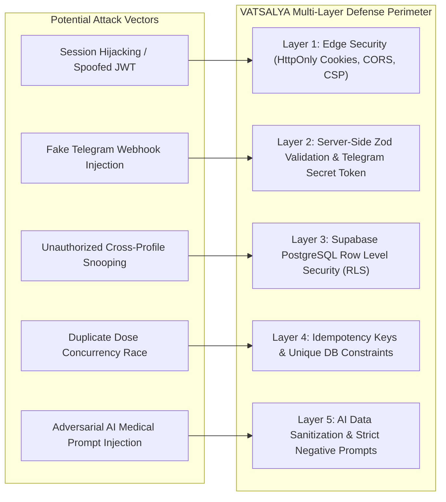

# VATSALYA (वात्सल्य) — Security, Privacy & AI Safety Architecture

> **Security Mandate:** Healthcare data demands strict defense-in-depth. Every transaction is authenticated via cryptographic sessions, validated through server-side Zod schemas, and governed by PostgreSQL Row Level Security (RLS). AI and voice engines are strictly constrained by clinical safety guardrails.

---

## 1. Multi-Layer Threat Model & Defense Perimeter



---

## 2. Access Control, Passcode Security & RLS

### 2.1 Cryptographic Passcode Access Security
- **No Static Passcodes:** Static shared PINs represent a severe vulnerability.
- **VATSALYA Passcode Lifecycle:**
  1. A 6-digit cryptographically secure pseudo-random number (CSPRNG) is generated on the server.
  2. The plaintext passcode is hashed using **SHA-256** prior to insertion in `profile_access_invitations`.
  3. The invitation carries a mandatory **48-hour expiration timestamp** (`expires_at`).
  4. Upon redemption by an authenticated user, `used_at` and `used_by` are permanently stamped, invalidating the code for further use.
  5. The elderly individual or primary family admin can revoke active access at any time via a single button tap, immediately deleting the row from `profile_access_members`.

### 2.2 Row Level Security (RLS) Policies
- All clinical tables (`healthcare_profiles`, `medications`, `medication_schedules`, `dose_logs`, `appointments`, `care_activities`, `care_insights`) enforce RLS.
- Access is governed through a stable `SECURITY DEFINER` function `has_healthcare_access(healthcare_profile_id)` operating strictly under `SET search_path = public`.
- The public Anon role has zero read or write access on any clinical data.

---

## 3. Telegram Webhook & Notification Channel Security

### 3.1 Telegram Webhook Secret Verification
- The Telegram webhook endpoint `/api/telegram/webhook` is configured with a secret token (`TELEGRAM_WEBHOOK_SECRET`).
- Incoming POST requests from Telegram must include the header:
  ```http
  X-Telegram-Bot-Api-Secret-Token: <SECRET_TOKEN>
  ```
- Any request lacking or mis-matching this token is immediately rejected with HTTP 401 Unauthorized before parsing request bodies.

### 3.2 Bot Token Protection
- `TELEGRAM_BOT_TOKEN` is retained exclusively within server-side environment variables and Google Secret Manager. It is strictly excluded from client-facing JavaScript bundles (`NEXT_PUBLIC_*`).

### 3.3 Notification Deduplication & Idempotency
To prevent notification storms and redundant emails/messages:
$$\text{idempotency\_key} = \text{MD5}(\text{healthcare\_profile\_id} + \text{schedule\_id} + \text{scheduled\_date} + \text{channel} + \text{trigger\_type})$$
- Unique index on `notifications(idempotency_key)` ensures that even if Cloud Scheduler retries a failed HTTP cycle, no recipient receives duplicate alerts.

---

## 4. Clinical AI Safety & Google Gemini Guardrails

### 4.1 Strict Linguistic Role (Zero Diagnostic Authority)
Google Gemini 1.5 Flash is integrated strictly as an **empathic linguistic summarizer and plain-language explainer**. It is explicitly forbidden from acting as a clinician.

```typescript
export const GEMINI_CLINICAL_SYSTEM_INSTRUCTION = `
You are the VATSALYA Compassionate Healthcare Assistant. Your sole purpose is to summarize and explain the user's verified, authorized healthcare schedule in warm, clear, and dignified language.

CRITICAL HEALTHCARE SAFETY DIRECTIVES:
1. You MUST NEVER diagnose conditions, propose treatments, or recommend altering medication doses or timings.
2. You MUST NEVER advise a patient whether to take an extra pill, skip a pill, or combine medications.
3. If the user mentions experiencing acute or severe symptoms (such as chest pain, breathlessness, loss of vision, or sudden weakness), you MUST instruct them to stop immediately and contact emergency medical services (112 / 108 in India) or their emergency contact.
4. Only summarize the structured JSON facts provided. Never speculate, extrapolate, or hallucinate clinical information.
5. Keep tone supportive, respectful, and dignified.
`;
```

### 4.2 PII Sanitization Pipeline
Before passing healthcare context to the Gemini API, server-side utilities strip all personally identifying information:
- Full legal names are masked to first names only (e.g. "Appaji").
- Government IDs, phone numbers, email addresses, and database UUIDs are completely stripped.
- Only clinical scheduling facts (`medication_name`, `strength`, `scheduled_time`, `meal_context`, `appointment_time`) are submitted.

### 4.3 Deterministic Fallbacks
If the Gemini API encounters rate limits (429), timeouts ($> 4000\text{ ms}$), or network dropouts:
- The system returns a pre-compiled, deterministic template:  
  *"You have [N] medications scheduled today. Next dose: [Medication Name] at [Time]."*
- No user is ever blocked or left uninformed due to an AI outage.

---

## 5. Voice Interaction Safeguards (Gnani.ai)

### 5.1 Two-Step Confirmation Requirement
- **Voice Cannot Directly Mark Doses as Taken:** Voice commands can query today's schedule (e.g., *"Did I take my afternoon tablet?"*), but cannot execute state mutations without physical user confirmation.
- If a spoken command states *"Mark my tablet taken"*, the system speaks back: *"I can help you with that. Please tap the green confirm button on your screen to complete this."*
- This prevents accidental dose confirmations caused by television audio, background radio, or family conversations.
