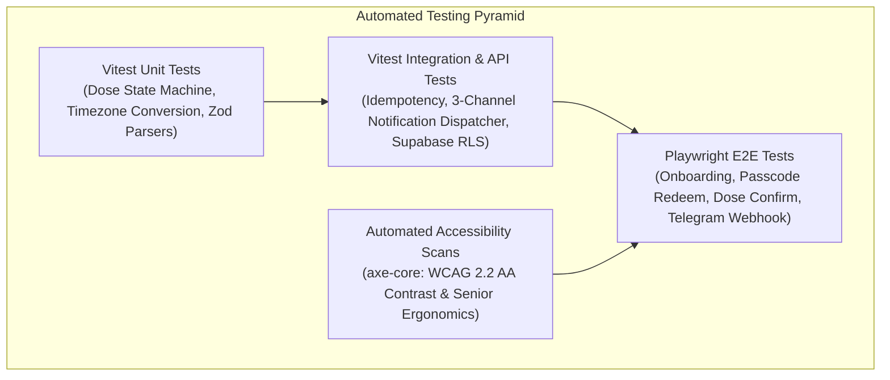

# VATSALYA (वात्सल्य) — Testing, CI/CD & Google Cloud Run Deployment

> **Deployment Tenet:** Early and continuous deployment on Google Cloud Run. A broken Cloud Run deployment disqualifies top candidates. We deploy a verified standalone container early in the hackathon cycle and continuously validate health.

---

## 1. Automated Testing Strategy



### 1.1 Test Suite Breakdown & Coverage Matrix

| Test ID | Test Category | Target Component | Test Scenario & Assertion |
| :--- | :--- | :--- | :--- |
| **TC-UNIT-01** | Unit | `evaluateDoseState()` | Asserts scheduled dose at 08:30 AM evaluates to `DUE` between 08:00–09:00 AM. Evaluates to `OVERDUE` at 09:01 AM if unconfirmed. |
| **TC-UNIT-02** | Unit | `generateIdempotencyKey()` | Asserts identical channel, schedule, and date inputs produce identical hash. |
| **TC-INT-01** | Integration | `POST /api/doses/confirm` | Asserts first confirmation returns 200 OK. Parallel concurrent request with identical payload returns 409 Conflict. |
| **TC-INT-02** | Integration | `POST /api/profile-access/redeem` | Asserts valid 6-digit code binds user to healthcare profile; expired code (>48h) returns 400 Bad Request. |
| **TC-INT-03** | Integration | `POST /api/telegram/webhook` | Asserts webhook with invalid secret token returns 401 Unauthorized. Valid callback query `dose_taken` confirms dose in DB. |
| **TC-INT-04** | Integration | 3-Channel Notifier | Asserts single notification run logs exactly one record in `notifications` per channel; rerun skips duplicate dispatch. |
| **TC-SEC-01** | Security / RLS | Supabase RLS | Caretaker account attempts to query healthcare profile of unlinked patient; asserts 0 rows returned. |
| **TC-A11Y-01**| Accessibility | Elderly Dashboard | Runs `axe-core` scan; asserts zero violations of WCAG 2.2 AA (color contrast $\ge 4.5:1$, touch targets $\ge 56\text{ px}$). |

---

## 2. Early Deployment Checkpoint & Cloud Run Setup

To eliminate last-minute deployment panic, the Google Cloud Run deployment pipeline is executed **in Milestone 1** as soon as the project skeleton and `/api/health` route are created.

### 2.1 Multi-Stage `Dockerfile` (Next.js Standalone)

```dockerfile
# Stage 1: Dependencies
FROM node:20-alpine AS deps
RUN apk add --no-cache libc6-compat
WORKDIR /app
COPY package.json package-lock.json ./
RUN npm ci

# Stage 2: Builder
FROM node:20-alpine AS builder
WORKDIR /app
COPY --from=deps /app/node_modules ./node_modules
COPY . .

ENV NEXT_TELEMETRY_DISABLED=1
ENV NODE_ENV=production

RUN npm run build

# Stage 3: Runner
FROM node:20-alpine AS runner
WORKDIR /app

ENV NODE_ENV=production
ENV NEXT_TELEMETRY_DISABLED=1
ENV PORT=8080
ENV HOSTNAME="0.0.0.0"

RUN addgroup --system --gid 1001 nodejs
RUN adduser --system --uid 1001 nextjs

COPY --from=builder /app/public ./public
COPY --from=builder --chown=nextjs:nodejs /app/.next/standalone ./
COPY --from=builder --chown=nextjs:nodejs /app/.next/static ./.next/static

USER nextjs

EXPOSE 8080

CMD ["node", "server.js"]
```

---

## 3. Google Cloud Run Deployment Commands

```bash
# 1. Set Google Cloud project
gcloud config set project vatsalya-healthcare

# 2. Enable necessary GCP APIs
gcloud services enable \
    run.googleapis.com \
    cloudbuild.googleapis.com \
    artifactregistry.googleapis.com \
    secretmanager.googleapis.com \
    cloudscheduler.googleapis.com

# 3. Create Artifact Registry repository
gcloud artifacts repositories create vatsalya-repo \
    --repository-format=docker \
    --location=asia-south1 \
    --description="VATSALYA Docker Repository"

# 4. Build and submit container via Cloud Build
gcloud builds submit --tag asia-south1-docker.pkg.dev/vatsalya-healthcare/vatsalya-repo/vatsalya-app:latest .

# 5. Deploy container to Google Cloud Run
gcloud run deploy vatsalya-app \
    --image asia-south1-docker.pkg.dev/vatsalya-healthcare/vatsalya-repo/vatsalya-app:latest \
    --platform managed \
    --region asia-south1 \
    --allow-unauthenticated \
    --min-instances 1 \
    --max-instances 5 \
    --memory 1Gi \
    --cpu 1 \
    --port 8080 \
    --set-secrets="NEXT_PUBLIC_SUPABASE_URL=SUPABASE_URL:latest,\
NEXT_PUBLIC_SUPABASE_ANON_KEY=SUPABASE_ANON_KEY:latest,\
SUPABASE_SERVICE_ROLE_KEY=SUPABASE_SERVICE_ROLE_KEY:latest,\
GEMINI_API_KEY=GEMINI_API_KEY:latest,\
GNANI_API_KEY=GNANI_API_KEY:latest,\
TELEGRAM_BOT_TOKEN=TELEGRAM_BOT_TOKEN:latest,\
TELEGRAM_WEBHOOK_SECRET=TELEGRAM_WEBHOOK_SECRET:latest,\
RESEND_API_KEY=RESEND_API_KEY:latest,\
CRON_SECRET=CRON_SECRET:latest"
```

---

## 4. Google Cloud Scheduler Setup

```bash
# Set up recurring 10-minute notification runner
gcloud scheduler jobs create http vatsalya-notification-worker \
    --schedule="*/10 * * * *" \
    --uri="https://vatsalya-app-xyz.a.run.app/api/jobs/notifications" \
    --http-method=POST \
    --headers="Content-Type=application/json,Authorization=Bearer YOUR_CRON_SECRET" \
    --location=asia-south1 \
    --description="Triggers VATSALYA 3-channel medication reminder dispatcher every 10 minutes."
```

---

## 5. Production Health Check & Verification Checklist

### 5.1 `/api/health` Route Implementation
A lightweight, non-cached health endpoint checking container responsiveness and live Supabase PostgreSQL connectivity:

```typescript
// app/api/health/route.ts
import { NextResponse } from 'next/server';
import { createClient } from '@supabase/supabase-js';

export const dynamic = 'force-dynamic';

export async function GET() {
  const start = Date.now();
  try {
    const supabase = createClient(
      process.env.NEXT_PUBLIC_SUPABASE_URL!,
      process.env.NEXT_PUBLIC_SUPABASE_ANON_KEY!
    );
    const { error } = await supabase.from('healthcare_profiles').select('id').limit(1);
    if (error) throw error;

    return NextResponse.json({
      status: 'healthy',
      uptime: process.uptime(),
      latencyMs: Date.now() - start,
      channels: {
        fcmReady: true,
        telegramReady: Boolean(process.env.TELEGRAM_BOT_TOKEN),
        resendReady: Boolean(process.env.RESEND_API_KEY)
      },
      timestamp: new Date().toISOString()
    }, { status: 200 });
  } catch (err: any) {
    return NextResponse.json({
      status: 'unhealthy',
      error: err.message,
      timestamp: new Date().toISOString()
    }, { status: 503 });
  }
}
```

### 5.2 Pre-Submission Verification Checklist
- [ ] Early Cloud Run deployment verified in Milestone 1 (`/api/health` returns HTTP 200).
- [ ] TypeScript check (`npx tsc --noEmit`) passes with 0 errors.
- [ ] Vitest test suite passes 100% of unit and integration tests.
- [ ] Playwright E2E passes critical paths (Onboarding $\to$ Passcode Redeem $\to$ Dose Confirmation).
- [ ] Telegram Bot webhook registered and tested (`/start` account linking, dose taken button callback).
- [ ] Email reminder dispatched via Resend and received in test inbox.
- [ ] Android FCM registration endpoint tested with sample device token.
- [ ] Live Cloud Run URL tested on a mobile device on a live cellular connection.
